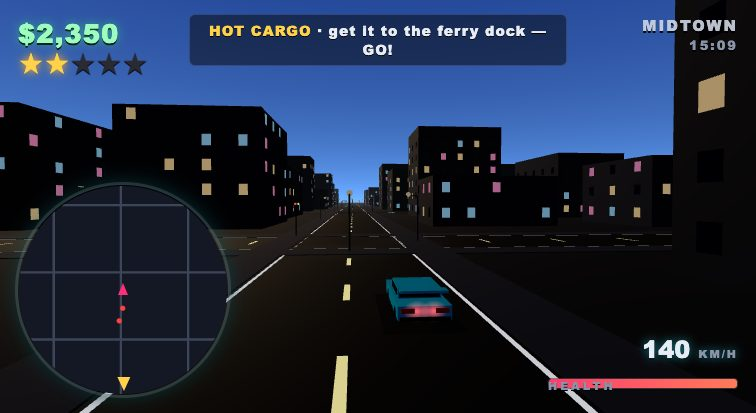
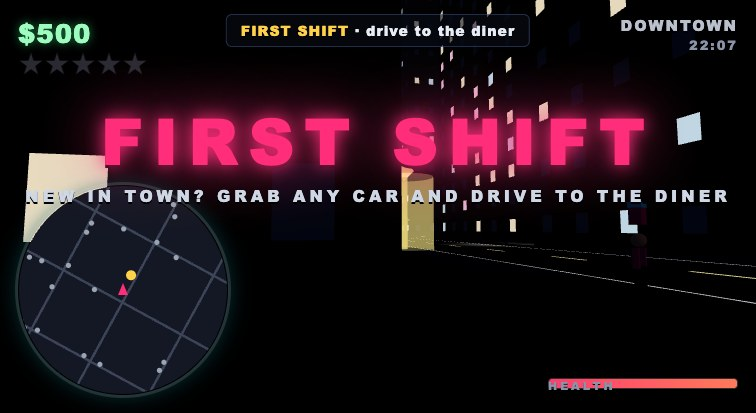

# NEON HARBOR

A top-down GTA-style joyride through a neon harbor district. Pure Canvas 2D,
zero dependencies, zero network requests — twelve ES modules and a seeded
random generator, nothing else. Repo: AgentPeterTeo/neon-harbor, bounty
[gta6-01](https://make.fun/bounty/gta6-01).

## What's in the game

- **A seeded city** — a 12×12 procedural grid off one LCG: building silhouettes
  with lit windows, parks, and a whole water column to the east with a glowing
  pier and a bridge. Same seed, same city, every time.
- **Arcade driving** — throttle, brake, reverse; lateral grip that lets go
  when you haul into a corner, laying skid marks and throwing sparks. The
  speedo runs to about 170 KM/H; hull damage adds up until the ride is
  WASTED. The camera leans into the throttle and pulls back with speed.
- **Traffic that behaves** — AI cars locked to their lanes, braking for each
  other and for you, day and night.
- **Wanted system** — 1 to 5 stars. Harbor PD cruisers spawn on the grid and
  hunt you down; get caught at a crawl with a cruiser on your hood and the
  run ends in BUSTED — Enter puts you back on the street, the interrupted
  contract reopens.
- **Five contracts** — a mission chain that pays in cash:
  1. HOT CARGO — $500, grab the stash and run it to the pier dock.
  2. LOSE THE HEAT — $400, shake off a two-star tail.
  3. HARBOR RUSH — $600, three checkpoints around the city, 60 seconds.
  4. GRAND THEFT — $800, run down a GT that doesn't want to be caught.
  5. HOME RUN — $1500, get to the safehouse with four stars on your back.

  The next contract arms a few seconds after the last one lands — no menus,
  the city itself hands out the work, and the pulsing marker plus a minimap
  dot always show where to go.
- **Day and night** — a full cycle bends over the city; night drops a dark
  grade and lights every headlight, window and neon sign.
- **HUD** — cash, hull, KM/H speedo, the in-game clock, wanted stars, the
  contract line, toasts, and a corner minimap with the mission marker,
  cops and your heading.

## Run it

Play (any static file server works; the kit ships one):

    node serve.ts

then open http://localhost:8080.

Build the dossier artifact (copies `game/` + `screenshots/` and writes
`out/dossier.json`):

    mkdir -p out && MAKEFUN_OUTPUT_DIR=out node main.ts

Deterministic screenshot contract — same three shots the repo ships with:

    ?shot=start&seed=1    title postcard
    ?shot=play&seed=1     mid-day drive, contract 1 live
    ?shot=mission&seed=1  night run on the pier approach

Any other query just plays.

## Controls

- **WASD / arrow keys** — throttle, brake/reverse, steer
- **Drift** — hold a turn above ~100 KM/H; the rear steps out and lays rubber
- **P** — pause
- **Enter / Space** — confirm, restart after BUSTED or WASTED

## Tech notes

- 960×540 canvas, plain `getContext('2d')`, requestAnimationFrame with a
  fixed 1/60 timestep.
- Every random roll in the game comes from one seeded LCG — `Math.random`
  appears nowhere — so a seed pins the city, the traffic, the mission chain.
- No build step, no imports from npm, no network; `game/index.html` runs
  straight off the file system.
- Verified by a scripted headless run: title → drive (167 KM/H clocked on
  the speedo) → pause/resume → contract 1 going live with its marker, with
  zero console errors across the three screenshot queries.

Shipped for [make.fun](https://make.fun/?ref=dc8zdfzd) — ref=dc8zdfzd
